# Setup Guide — Proton Drive NAS Sync

A step-by-step first-time setup walkthrough with screenshots. Covers deploying the
container, signing in to Proton Drive (including 2FA, two-password, and CAPTCHA),
and using the dashboard.

> **⚠️ Third-party application — not affiliated with, endorsed by, or supported by
> Proton AG.** It's a good idea to test against a throwaway Proton account first.
> All screenshots below use fake placeholder data.

For deployment specifics (NAS bind mounts, environment variables, security
hardening, troubleshooting), see [DEPLOY.md](DEPLOY.md). For a reference of every
feature and option in the UI, see [USER_GUIDE.md](USER_GUIDE.md).

---

## 1. Prerequisites

- **Docker** with Docker Compose.
- A **Proton account** with Proton Drive.
- (Only if building from source) **Node.js ≥ 26**.

---

## 2. Deploy the container

Clone, build, and start:

```bash
git clone git@github.com:grumpyspud/proton-drive-nas-sync.git
cd proton-drive-nas-sync
docker build -t proton-drive-nas-sync:latest .
docker compose up -d
```

Then open `http://<host>:8787`. On first load you'll land on the Proton sign-in
screen.

The container needs two persistent paths:

| Path      | Purpose                                                                 |
|-----------|-------------------------------------------------------------------------|
| `/config` | Encrypted session blob, sync database, backup file, and audit log.     |
| `/data`   | The local folders you pair with Proton Drive folders.                  |

Bind your NAS shares under `/data/<name>` (see [DEPLOY.md](DEPLOY.md) for a full
compose example).

---

## 3. First run — set an app password (recommended)

Before signing in to Proton, add a second layer of protection by setting an
**app password**. It locks the whole dashboard behind its own password on top of
the Proton login.

Click **"Set app password"** below the sign-in form:

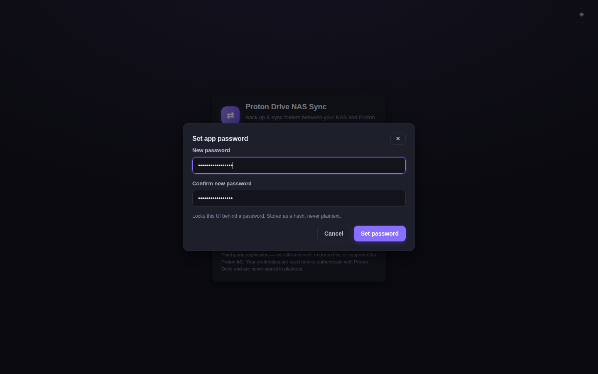

Enter a new password (minimum 6 characters) and confirm it. It is stored as a
scrypt hash — never in plaintext. You can change it later from the top bar
(**🔒 App password**).

> If you don't set one, the app shows a warning banner and the dashboard is open
> to anyone who can reach the address.

---

## 4. Sign in to Proton

Enter your Proton username and password and press **Sign in**.

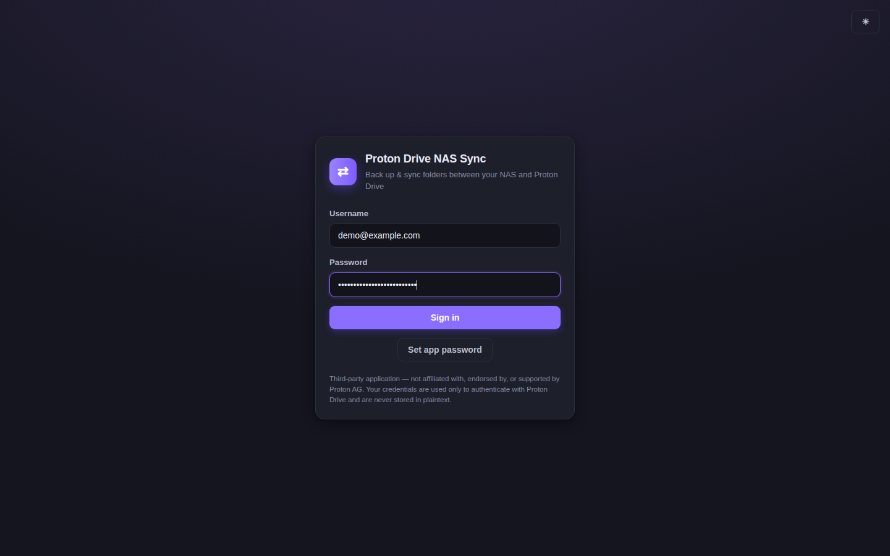

Depending on your account's security settings, Proton may walk you through one or
more of the next steps. The order is: **CAPTCHA → two-factor code → mailbox
password** (any step is skipped if you don't have it enabled).

---

## 5. Human verification (CAPTCHA)

If Proton flags the sign-in (common from a new IP or a fresh Docker container),
you'll see this screen. It asks you to open Proton's verification page, run a small
snippet in that page's console to capture the solved token, and paste the token
back here.

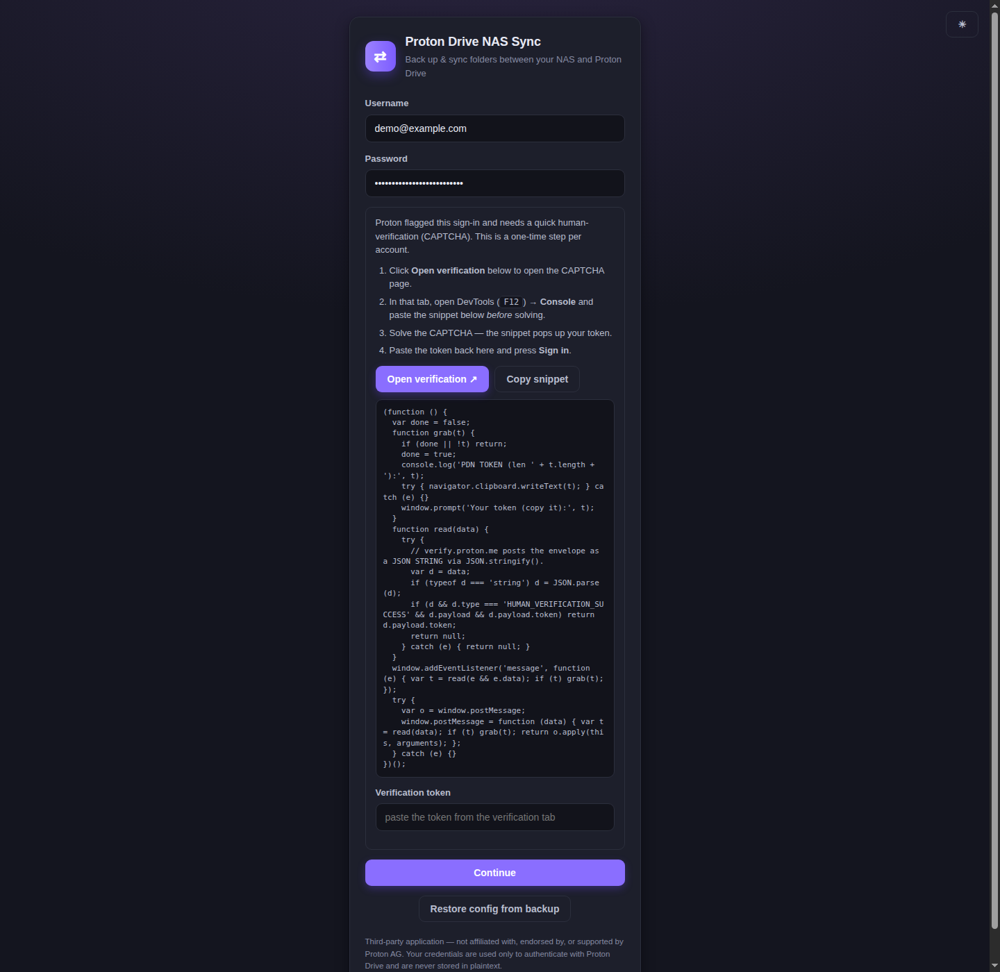

**Steps:**

1. Click **Open verification ↗** to open the CAPTCHA page in a new tab.
2. In *that* tab, open DevTools (`F12`) → **Console**, paste the snippet, and
   solve the CAPTCHA.
3. The snippet pops up your token (and copies it to the clipboard when allowed).
4. Paste the token into **Verification token** here and press **Continue**.

> **Note — the "Copy snippet" button may not copy.**
> The button uses the browser clipboard API, which some browsers (notably
> **Firefox**) may silently block. If nothing is copied, just select the code in
> the box and copy it manually (`Ctrl+C` / right-click → Copy).

> **Note — you may need to type `allow pasting` first.**
> The first time you open the DevTools console on the verification tab, the browser
> may block pasting and show an "allow pasting" notice. Type `allow pasting` and
> press Enter, then paste the snippet. (Usually only needed once per browser.)

---

## 6. Two-factor authentication (2FA)

If your account has two-factor authentication enabled, enter your authenticator
code:

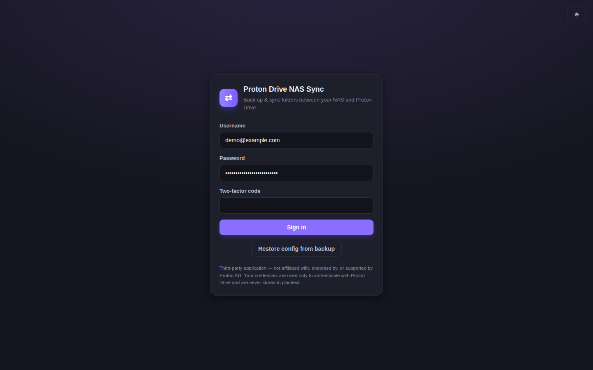

---

## 7. Mailbox password (two-password mode)

Proton accounts created with two-password mode ask for a second "mailbox
password" that encrypts your data:

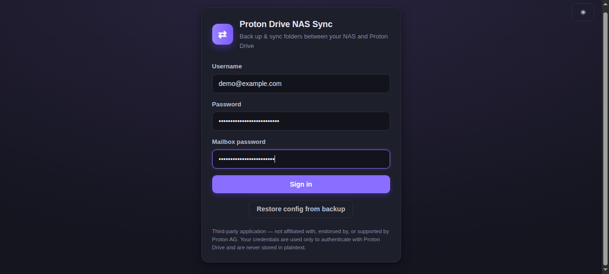

After this, you're signed in. The session is persisted as an AES-256-GCM encrypted
blob in `/config`, so you won't be prompted again on restarts.

---

## 8. The dashboard

This is your home base:

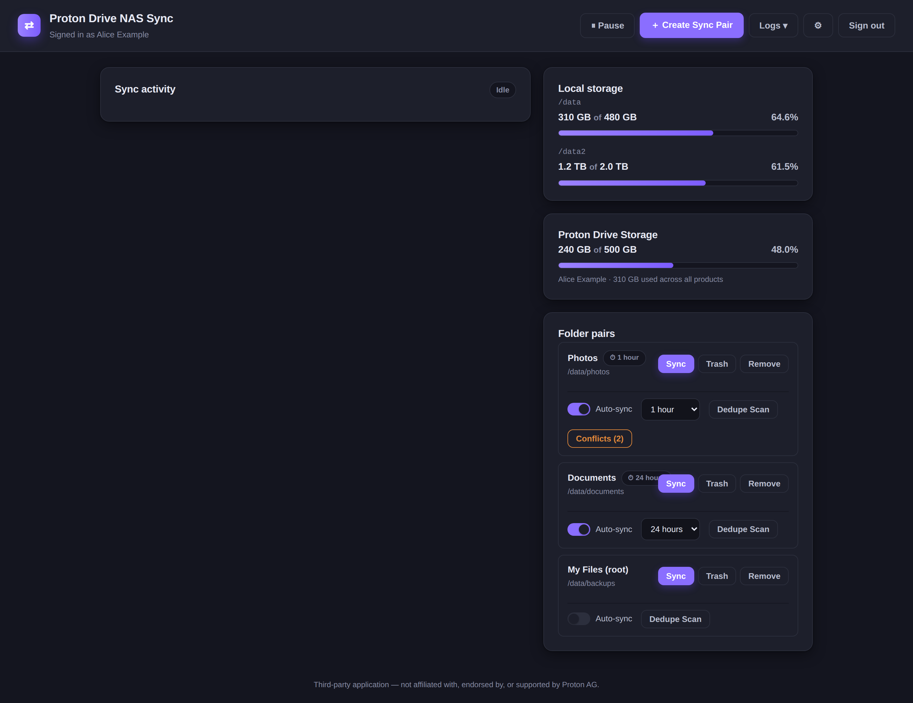

- **Left — Sync activity:** live progress bars (percent + speed), the last sync
  summary, and a status badge (Idle / Syncing / Paused).
- **Right — Storage:** your Proton Drive usage, with a warning when space runs low.
- **Right — Folder pairs:** the folders you're syncing, with per-pair Sync / Trash /
  Remove actions, an Auto-sync toggle, and a Dedupe Scan button.

The top bar holds the global controls:

- **⏸ Pause / ▶ Resume** — pause or resume all syncing.
- **⏹ Stop** (shown only while syncing) — stop the current sync.
- **＋ Create Sync Pair** — add a folder pair.
- **Logs ▾** — open the **Sync log**, **Activity log**, or **Error log** (see
  [step 13](#13-viewing-logs)).
- **⚙ Settings** — **💾 Backup**, **🔒 App password**, **🔐 Lock**,
  **☀ Light / 🌙 Dark**, and **Max concurrent transfers**.
- **Sign out**.

---

## 9. Add a folder pair

Click **＋ Create Sync Pair** in the top bar, then browse (or type) the local
folder on the NAS and the matching Proton Drive folder:

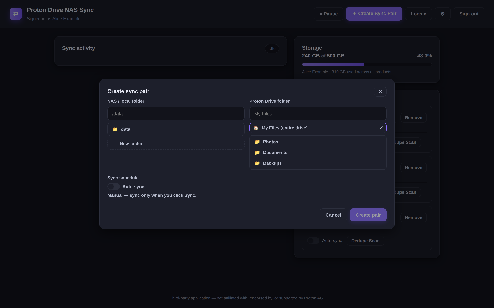

- **NAS / local folder** — an absolute path under `/data` (e.g. `/data/photos`).
  You can browse subfolders or click **New folder** to create one.
- **Proton Drive folder** — pick an existing Drive folder, or **My Files (entire
  drive)** to sync the whole drive.
- **Sync schedule** — either **Manual** (sync only when you click **Sync**) or
  **Auto-sync** on a schedule, with a frequency from **1 min** through **Monthly**.

Click **Create pair**, then **Sync** to run it immediately.

> **Deletion safety.** Deletions are trashed before being removed, and if a sync
> would delete more than a safety threshold of tracked files (for example, because
> a source folder vanished), the app pauses and asks for explicit confirmation
> before doing anything destructive.

---

## 10. Locking the app

**🔐 Lock** re-locks the app password gate without signing you out of Proton.
Re-enter the app password to continue:

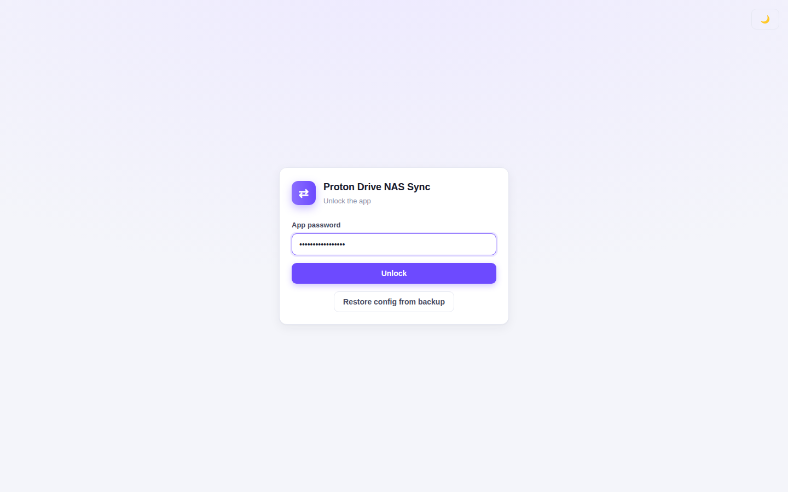

---

## 11. Back up your config

**💾 Backup** exports a single encrypted file containing your folder pairs, the
Proton session, and the encryption key. This is how you move or rebuild the app
without re-signing in and re-adding every pair.

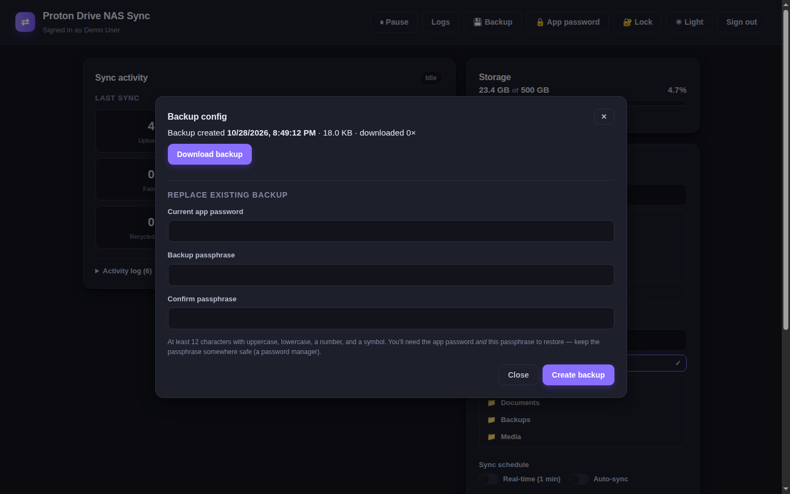

Creating a backup requires:

- The current **app password**, and
- A **passphrase** (12+ characters with upper + lower case, a number, and a
  symbol).

The file is encrypted with a combination of both, so anyone who gets the file
still can't open it without your secrets. Download it and store it somewhere safe
(off the NAS). Creating a new backup prompts before overwriting the existing one.

---

## 12. Restore your config

Restore is available from the sign-in / unlock screen (before any Proton login) —
exactly where you'd need it on a fresh NAS or rebuild.

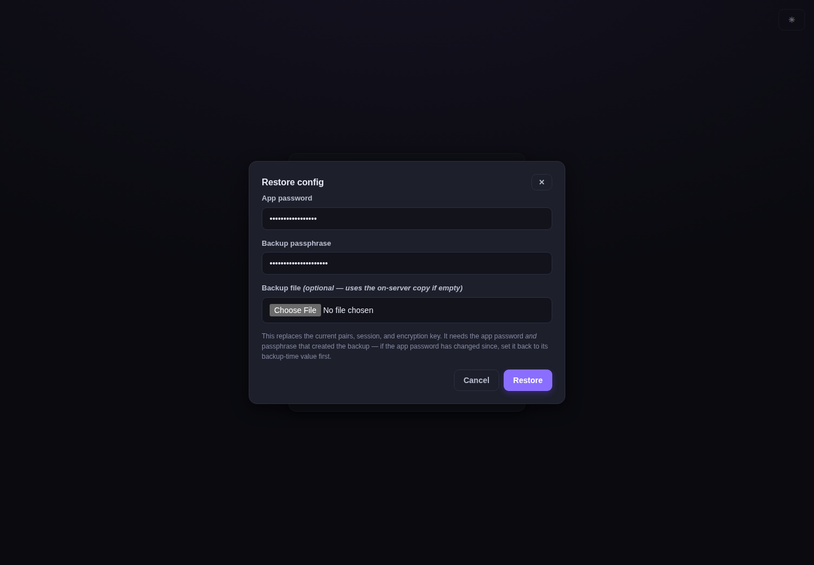

To restore:

1. Make sure you're **signed out of Proton**.
2. Enter the **app password** and the **backup passphrase**.
3. Optionally select a downloaded `.pdnbak` file (leave empty to use the copy in
   `/config`).

> **Important:** the app password is part of the encryption key, so you must use
> the *same app password value* that was set when the backup was created. On a new
> install, set the app password to its backup-time value first, restore, then
> change it.

---

## 13. Viewing logs

The **Logs ▾** menu has three views:

- **Sync log** — the full, searchable, downloadable server log (the persistent log
  written at `/config/sync.log`):

  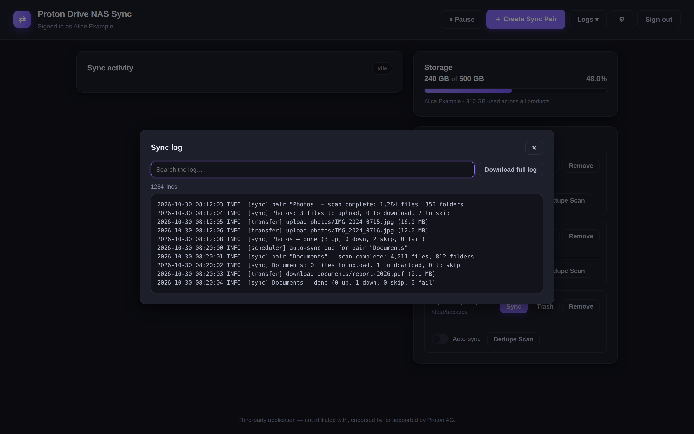

- **Activity log** — the most recent sync actions from the current session
  (capped at 200 events), shown in the browser:

  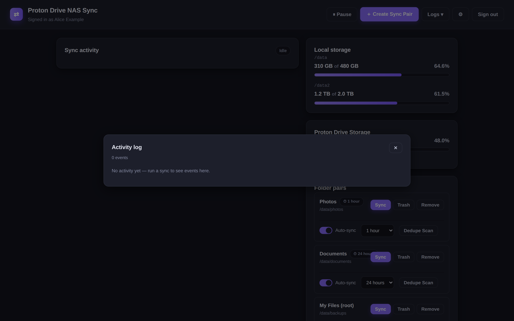

- **Error log** — a separate, persistent log of **errors**, **conflicts**, and
  **warnings** only:

  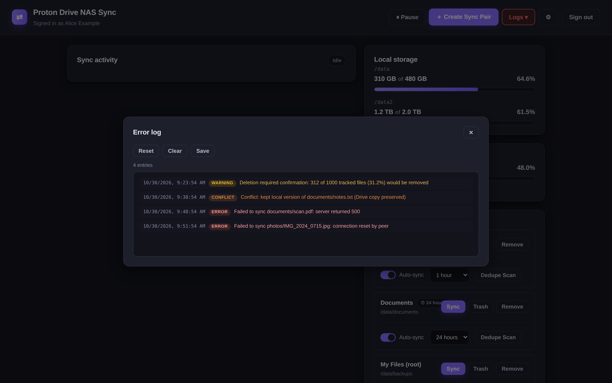

The **Logs ▾** button itself is a live indicator: it turns **red** when there are
new (unseen) errors, or **yellow** for new warnings/conflicts. Open **Logs ▾ →
Error log** to review them — entries are colour-coded by severity (**error** red,
**conflict** orange, **warning** yellow). Three actions sit at the top:

- **Reset** — mark the current entries as seen (clears the button back to normal).
- **Clear** — delete every entry.
- **Save** — download the whole log as a `.txt` file.

The error log exists because the main sync log is rotated once it grows large, so
an early problem on a long sync could scroll away. Errors, conflicts, and warnings
are written here as well, so they're never lost.

---

## 14. Light / dark theme

The UI defaults to dark. Toggle **☀ Light / 🌙 Dark** in the top bar:

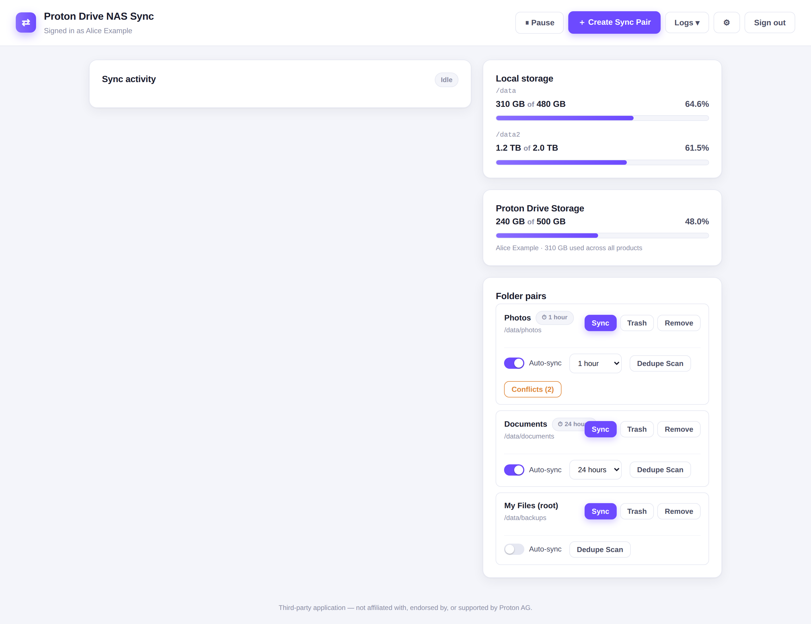

---

## 15. Updating

```bash
git pull
docker build -t proton-drive-nas-sync:latest .
docker compose up -d
```

If you pull the prebuilt image from the GitHub Container Registry instead, replace
the build step with `docker compose pull`.

---

## Troubleshooting

See [DEPLOY.md](DEPLOY.md) for the full list (healthcheck, logs, Proton rate
limiting, port conflicts). The CAPTCHA-specific notes are in
[step 5](#5-human-verification-captcha) above.
