# User Guide — Proton Drive NAS Sync

A reference for every feature and option in the web UI.

> **⚠️ Third-party application — not affiliated with, endorsed by, or supported by
> Proton AG.**

For first-time setup with screenshots see [SETUP.md](SETUP.md); for deployment,
environment variables, and security see [DEPLOY.md](DEPLOY.md).

---

## The dashboard

After signing in you land on the dashboard, with two columns:

- **Sync activity** (left) — the live status and progress of the current sync, plus
  the last-sync summary.
- **Local storage**, **Proton Drive Storage**, and **Folder pairs** (right) — your NAS volumes'
  usage, your Proton Drive usage, and the list of sync pairs.

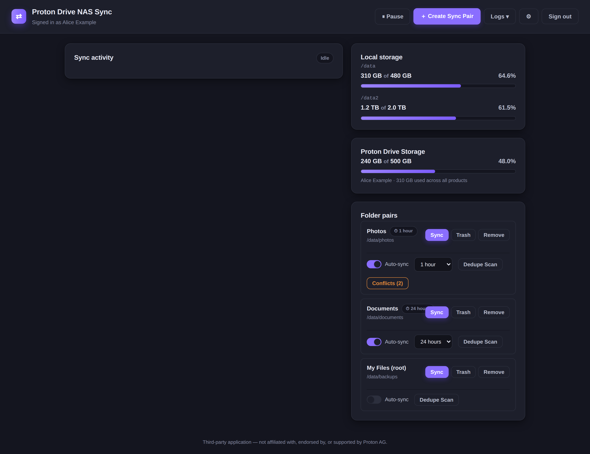

### Top bar

| Control | What it does |
|---|---|
| **⏸ Pause / ▶ Resume** | Pause or resume all syncing globally. |
| **⏹ Stop** | Stop the current sync (shown only while a sync is running). |
| **＋ Create Sync Pair** | Add a new folder pair. |
| **Logs ▾** | **Sync log** (recent server log, searchable, downloadable), **Activity log** (recent events), or **Error log** (errors/conflicts/warnings). Turns **red** (errors) or **yellow** (warnings/conflicts) when there are new entries. |
| **⚙ Settings** | Backup, app password, lock, theme, and max concurrent transfers. |
| **Sign out** | Sign out of Proton. |

---

## Sync pairs

A **sync pair** links a local folder on your NAS with a folder in Proton Drive and
keeps them in sync (additions, edits, and deletions on either side are mirrored to
the other).

### Creating a pair

1. Click **＋ Create Sync Pair** in the top bar.
2. **NAS / local folder** — browse or type an absolute path under a mounted
   volume (e.g. `/data/photos`). The app only accepts folders on a mounted
   volume; a path inside the container itself is rejected with a warning.
3. **Proton Drive folder** — pick an existing Drive folder, or **My Files (entire
   drive)** to sync the whole drive.
4. **Sync schedule** — **Manual** or **Auto-sync** (see below).
5. Click **Create pair**.

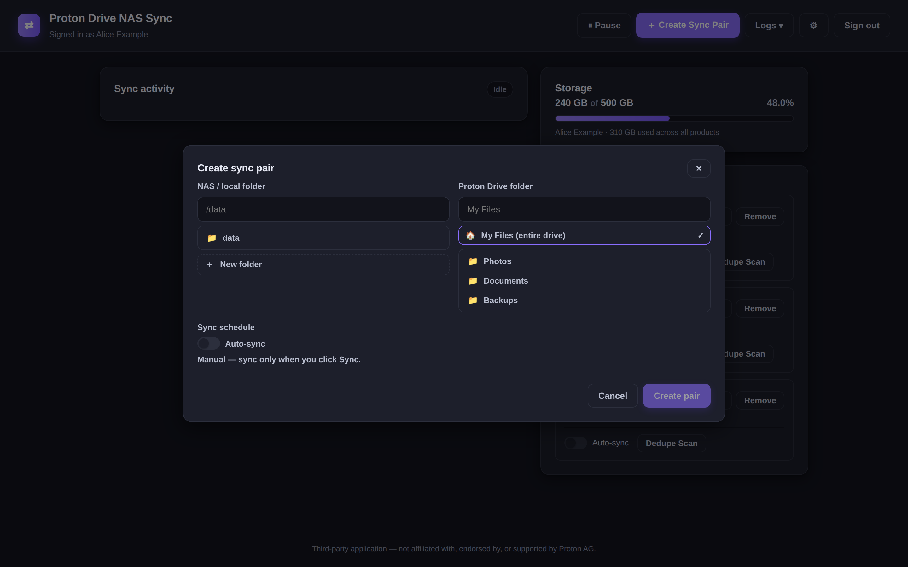

### Manual vs Auto-sync

- **Manual** — the pair only syncs when you click its **Sync** button.
- **Auto-sync** — the pair syncs automatically on the interval you choose.

| Frequency | Interval |
|---|---|
| 1 min | 60 seconds |
| 15 min | 15 minutes |
| 30 min | 30 minutes |
| 1 hour | 1 hour |
| 6 hours | 6 hours |
| 12 hours | 12 hours |
| 24 hours | 24 hours |
| Weekly | 7 days |
| Monthly | 30 days |

Change a pair's schedule any time with the **Auto-sync** toggle and the frequency
dropdown on its row.

---

## Running and controlling a sync

- **Sync** (on a pair) runs that pair immediately.
- **⏸ Pause / ▶ Resume** (top bar) pauses or resumes all syncing.
- **⏹ Stop** (top bar, while running) cancels the current sync.

While a sync runs, the **Sync activity** card shows:

- an **overall progress bar** — bytes and files transferred, percent + speed,
- a **per-file progress bar** for each file currently transferring,
- a **last-sync summary** — uploaded, downloaded, skipped, failed, conflicts,
  trashed on Drive, and recycled locally.

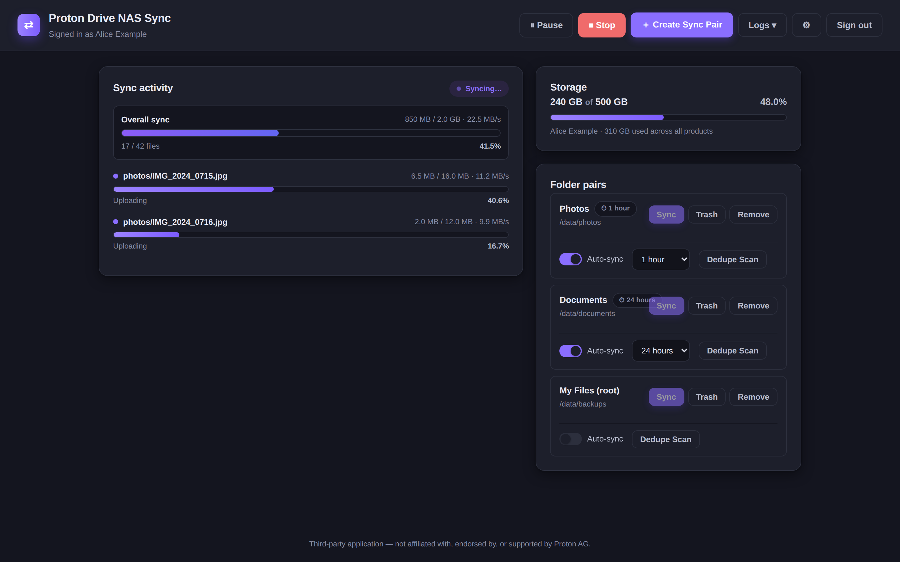

---

## Duplicate files (dedupe)

Each pair has a **Dedupe Scan** button that finds identical files (by content hash)
within that pair's local folder. Empty files are always skipped.

1. Click **Dedupe Scan** on a pair.
2. Choose a **minimum file size** (`No min size`, `1 KB`, `10 KB`, `100 KB`,
   `1 MB`, `10 MB`) and click **Scan**. The modal does not scan on its own.
3. Results are grouped by content — e.g. "3 identical copies · 4.2 MB each".

For each group, **check the copies you want to keep**; unchecked copies are the
ones that will be recycled. **If none are checked, everything is kept** — there is
deliberately no way to remove all copies at once.

- **Recycle N unselected** — moves the unchecked copies to the local trash
  (`.pdn-trash`); their Drive copies are trashed on the next sync.
- **Ignore** — hides that group from future scans.

Ignored files are listed at the bottom of the modal, grouped by content, where you
can **Reset** an individual group or **Reset all** to bring them back into scans.

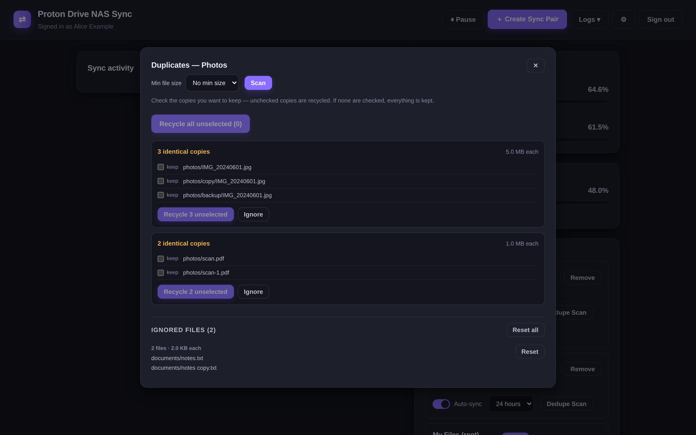

---

## Trash (recycle bin)

Deletions never happen immediately — files are recycled first. Click **Trash** on a
pair to see what's been recycled:

- **Restore** — put a file back.
- **Delete** — permanently remove a single recycled file.
- **Clear all** — permanently delete every recycled file for that pair.

Recycled local files live in a hidden `.pdn-trash` folder inside the pair's local
folder; on the Drive side, deletions go to Proton Drive's trash.

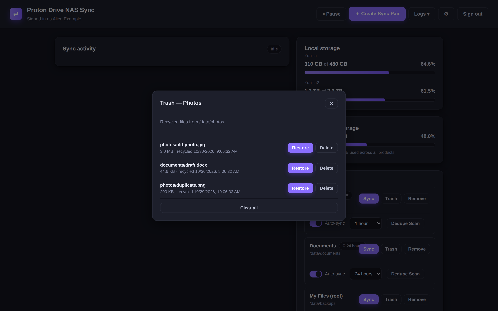

---

## Deletion safety

Several guards prevent a mistake from wiping data:

- **Trash before delete** — deletions are recycled/trashed, not removed outright.
- **Source-availability gate** — a sync won't delete files because a source folder
  is missing or a drive is offline.
- **Deletion-rate tripwire** — if a sync would delete more than **25%** of tracked
  files, it pauses and asks for explicit confirmation, showing exactly what would
  be trashed (Drive) and recycled (local).

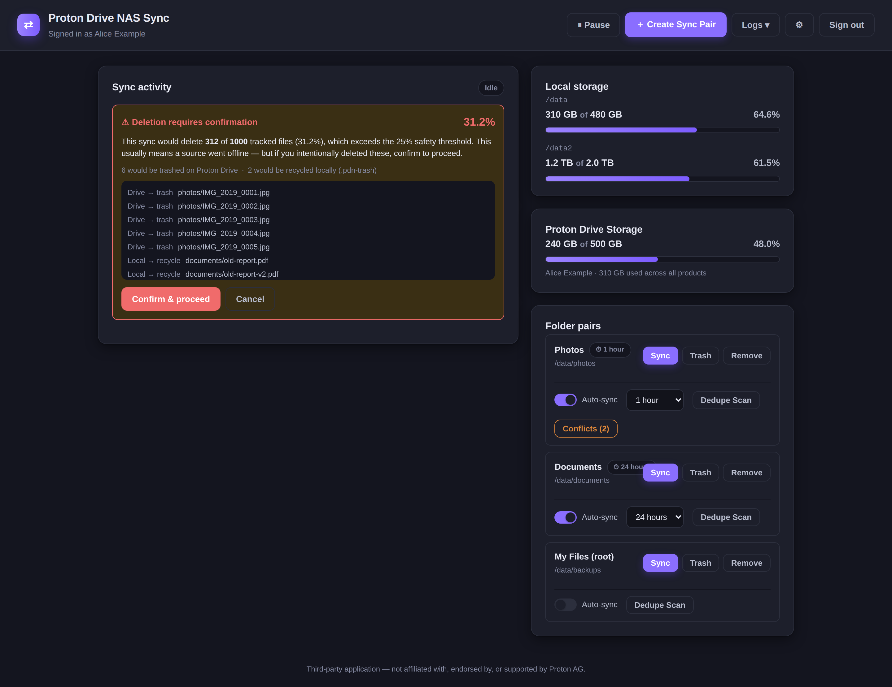

---

## Local storage

The **Local storage** card sits above the **Proton Drive Storage** card and shows
every data volume bind-mounted into the container (for example a single `/data`,
or separate `/data/photos` and `/data/documents` shares), with per-volume
used/total and a fill bar. The container's own storage and `/config` are excluded
automatically.

## Proton Drive Storage

The **Proton Drive Storage** card shows how much of your Proton Drive quota you're using.

- **Above 80%** — the bar turns yellow-orange.
- **Above 90%** — the bar turns red and a **"Warning: Drive space almost full"**
  message appears under it.

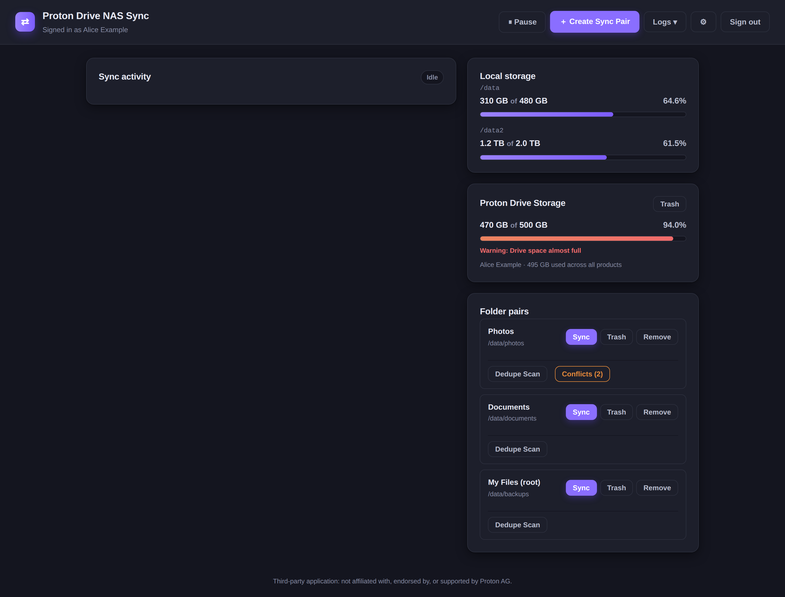

---

## Logs

The **Logs ▾** menu has three views:

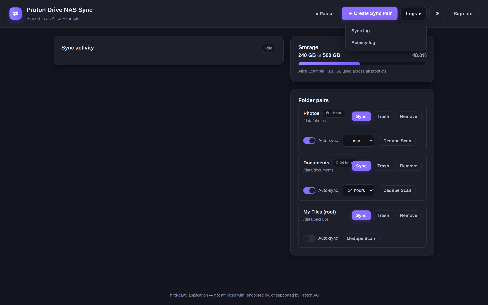

- **Sync log** — the recent server log (`/config/sync.log`), searchable
  and downloadable.

  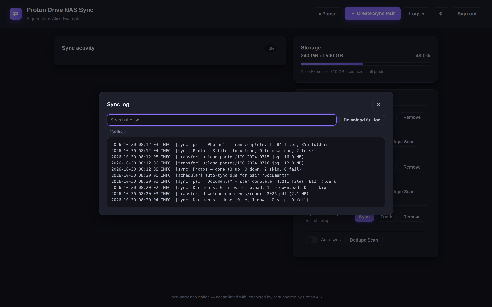

- **Activity log** — the most recent sync actions from the current browser session
  (capped at 200 events).

  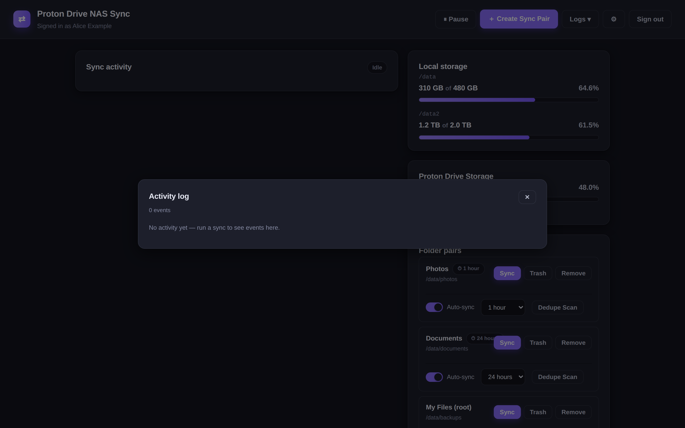

- **Error log** — a separate, persistent log of **errors**, **conflicts**, and
  **warnings** only (see below).

### Error log

The **Logs ▾** button turns **red** when there are unseen errors, or **yellow**
for unseen warnings/conflicts. Open **Logs ▾ → Error log** to review them:

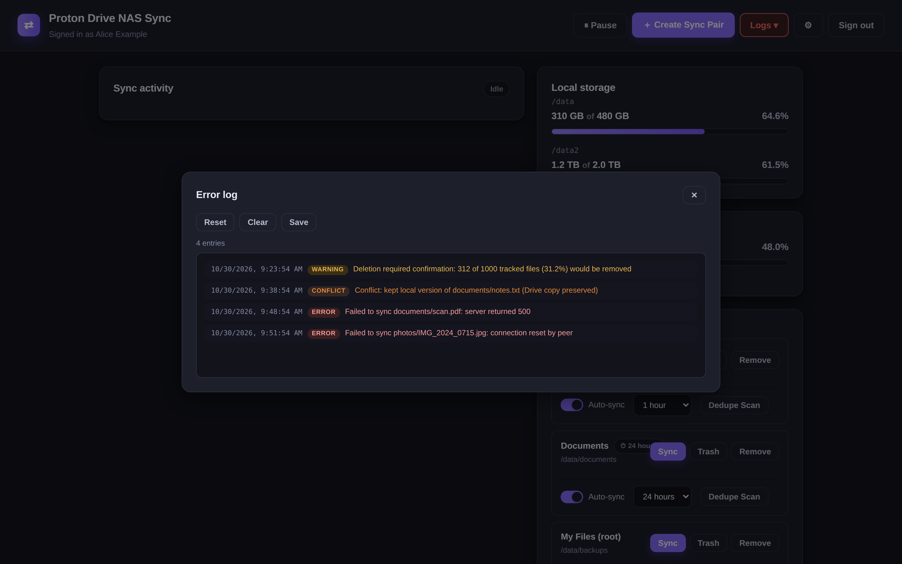

Entries are colour-coded by severity — **error** (red), **conflict** (orange),
**warning** (yellow). Three actions are available:

- **Reset** — mark the current entries as seen (returns the button to normal).
- **Clear** — delete every entry.
- **Save** — download the whole log as a `.txt` file.

> The main sync log is rotated once it grows large, so an early problem on a long
> sync could scroll away. The error log is separate and only records
> errors/conflicts/warnings, so those survive.

---

## Settings

The **⚙ Settings** menu holds:

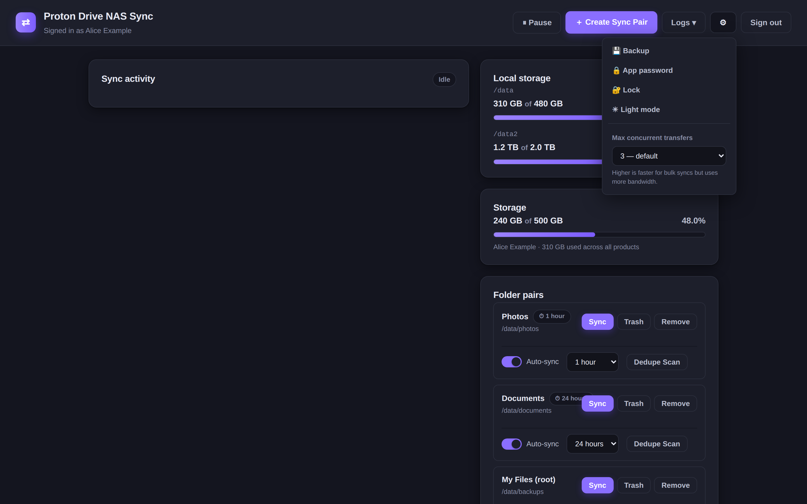

- **💾 Backup** — export an encrypted backup (see below).
- **🔒 App password / 🔓 Set password** — set or change the dashboard's own
  password.
- **🔐 Lock** — lock the dashboard without signing out of Proton (shown only when
  an app password is set).
- **☀ Light / 🌙 Dark** — switch the theme.
- **Max concurrent transfers** — how many files sync in parallel.

| Setting | Options | Default |
|---|---|---|
| Max concurrent transfers | 1 (sequential), 2, 3, 4 | 3 |

Higher concurrency is faster for bulk syncs but uses more bandwidth.

---

## App password & lock

The **app password** is an optional second lock (on top of Proton sign-in) that
protects the whole dashboard. Set it from **⚙ Settings → Set password** (minimum
6 characters). It is stored as a scrypt hash — never in plaintext.

**🔐 Lock** re-locks the app behind that password without signing you out of
Proton.

---

## Backup & restore

**💾 Backup** exports a single encrypted `.pdnbak` file containing your folder
pairs, Proton session, and encryption key — everything needed to move or rebuild
the app without re-signing in. It requires the **app password** and a **passphrase**
(12+ characters with upper + lower case, a number, and a symbol).

Restore is available from the sign-in screen (before Proton login). You'll need the
**app password** and **backup passphrase**, and — if restoring from a downloaded
file — the `.pdnbak` file itself.

> If you set an app password, it becomes part of the encryption key, so you must
> use the same value at restore time.
